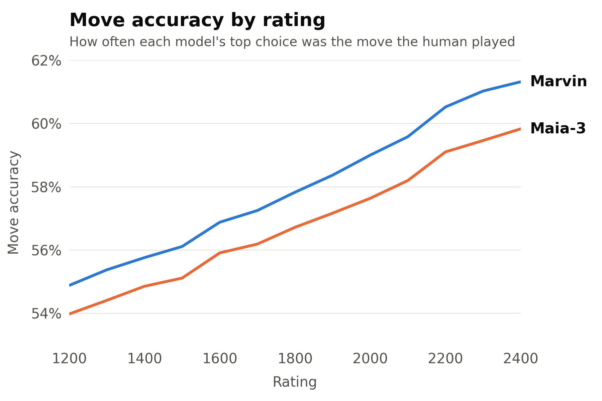

# Marvin

A chess engine that plays like a human of a chosen rating, including how long it thinks.
Marvin is a neural network trained on Lichess games. Besides the position and both players'
ratings, it is conditioned on the time control, both clocks and how long recent moves took, and
predicts the move a human would play and how long they would spend on it. So the same position is
played differently in bullet than in classical, or with ten seconds left rather than ten minutes:
faster, and with more mistakes, when short on time.



<sub>Marvin 79M and Maia-3 79M on 3.9M positions from rated Lichess games played after both models' training data ends, with equal numbers per time control (bullet, blitz, rapid) and 100-point rating band. Under Maia-3's own test protocol (blitz only, from ply 10, stopping once either clock is under 30 s), move accuracy is 58.93% for Marvin and 58.59% for Maia-3.</sub>

## Setup

Python 3.10+.

```
pip install -r requirements.txt
python download_weights.py
```

This downloads two models into `weights/`: `79m` (default, stronger human prediction) and `23m`
(smaller). Both run fast on CPU. Add `--fp32` for the full-precision files, which are twice the size
and give practically identical outputs. Run it again after an update: it replaces weights from before
sub-second think times (below).

Think times are predicted to 40 ms: the model predicts whole seconds (Lichess records clocks to the
second), and a small extra head trained on Lichess's centisecond clocks places the time within that
second. This matters mostly in bullet, where many human moves take well under a second.

The model's inputs and outputs are documented on the
[weights page](https://huggingface.co/holymolyyy/marvin-onnx).

## Play in the browser

```
python -m marvin.gui
```

Options: `--model 23m`, `--port 8000`. Move and think-time settings are in the page.

The board is [chessground](https://github.com/lichess-org/chessground). The sounds are Lichess's
standard set (move, capture, check, low time, game start and end). Their license is unclear, so they
aren't in the repo: the GUI fetches them from Lichess the first time and keeps them in
`marvin/static/sound/`. Turn them off with **Sound**.

With **Analysis** off you play Marvin. With it on, the board is free: you move both sides, Marvin
doesn't reply, and each move spends the model's typical think time on that side's clock. A table
shows the moves a human would play in the viewed position, with think times and expected results.
Step through the moves with ← and → (Home and End for the start and end) and play out variations.
Turning analysis off again continues the game against Marvin from the position on the board.

Tick **Debug** to see the exact model inputs and outputs behind each of Marvin's moves.

## Use as a UCI engine

Add `marvin.sh` (Linux/macOS) or `marvin.bat` (Windows) as an engine in any UCI GUI
(Cute Chess, En Croissant, Arena) or in [lichess-bot](https://github.com/lichess-bot-devs/lichess-bot).

| Option | Default | |
|---|---|---|
| `UCI_Elo` | 1500 | Marvin's rating (1200–2500) |
| `OpponentElo` | 0 | Opponent's rating. 0 = from `UCI_Opponent` if the GUI sends it, else same as `UCI_Elo` |
| `Model` | 79m | `79m` or `23m` |
| `Temperature` | 1.0 | Move sampling temperature. 1 = the model's distribution, 0 = always the most likely move |
| `TopP` | 1.0 | Only sample from the most likely moves covering this probability |
| `ThinkTime` | sample | `sample`: random draw from the predicted think time. `typical`: close to the most likely time, with some variation. `mean`: the average predicted time. `mode`: the single most likely time. `instant`: move immediately |
| `TimeTemperature` | 1.0 | Temperature for `sample` think times |
| `TimeTopP` | 1.0 | Top-p for `sample` think times |
| `TimeScale` | 1.0 | Multiplies think times (below 1 is faster, above 1 slower) |
| `Flag` | sample | When Marvin runs out of time. `sample`: with the model's probability of a human flagging in the position, but only with 5 seconds or less left. `threshold`: whenever that probability reaches 15%, at any clock. `never` |
| `BaseTime` | 0 | Game's base time in seconds. 0 = detect at game start |
| `FallbackTimeControl` | 5+0 | Time control assumed when the GUI sends no clock (minutes+increment) |
| `MoveOverhead` | 100 | Milliseconds kept in reserve per move, for GUI or network lag |

The standard `debug on` command makes Marvin print the model's inputs and outputs for every move.

### How time is handled

With a clock (normal games), the GUI sends both clocks and increments with every move. Marvin
detects the base time at the start of the game, measures the opponent's think time from the
clock, and then waits its own sampled think time before moving. Everything the model sees
(clocks, increments, recent move times) is real, rounded to whole seconds as in its training data.
When Marvin runs out of time (see `Flag`), it holds its move until its clock has expired, so the GUI
records a loss on time.

Without a clock (`go nodes`, `go infinite`, `go movetime`), Marvin assumes `FallbackTimeControl`,
estimates the missing move times with the model and simulates both clocks. It replies
immediately, or within `movetime` if one is given.

## How human-like is it?

On the same test set as the figure, Maia-3 / Marvin:

| | Move accuracy | Move NLL | WDL accuracy |
|---|---|---|---|
| All | 56.81% / 57.99% | 1.310 / 1.254 | 61.7% / 65.6% |
| Bullet | 53.58% / 55.98% | 1.461 / 1.338 | 59.4% / 66.1% |
| Blitz | 58.26% / 58.77% | 1.241 / 1.219 | 61.7% / 64.8% |
| Rapid | 58.59% / 59.22% | 1.228 / 1.206 | 64.1% / 65.8% |
| Clock over 50% of base time | 55.78% / 56.62% | 1.337 / 1.301 | 60.1% / 61.6% |
| Clock 20–50% | 59.85% / 61.18% | 1.204 / 1.145 | 67.5% / 73.8% |
| Clock 5–20% | 59.19% / 61.57% | 1.262 / 1.134 | 64.8% / 76.2% |
| Clock under 5% | 56.40% / 61.00% | 1.424 / 1.150 | 58.6% / 78.5% |

Think time in seconds given the move played, human / Marvin, on 639,393 held-out positions from
June 2021 with centisecond clocks (Maia-3 doesn't predict think time):

| | Mean | Median | 90th percentile | Median error |
|---|---|---|---|---|
| All | 4.59 / 4.56 | 2.16 / 2.08 | 10.92 / 10.72 | 0.80 |
| Bullet | 1.99 / 1.99 | 1.28 / 1.28 | 4.28 / 4.32 | 0.40 |
| Blitz | 4.97 / 4.91 | 2.72 / 2.64 | 11.52 / 11.36 | 1.04 |
| Rapid | 9.46 / 9.45 | 5.28 / 5.04 | 22.24 / 22.16 | 2.16 |
| Under 10 s on the clock | 0.97 / 0.98 | 0.79 / 0.80 | 2.15 / 2.16 | 0.27 |

## Acknowledgments

Marvin's architecture builds on Chessformer, from Monroe et al.,
[Chessformer: A Unified Architecture for Chess Modeling](https://arxiv.org/abs/2605.19091) (ICLR 2026).

## License

GPL-3.0, see [LICENSE](LICENSE).
